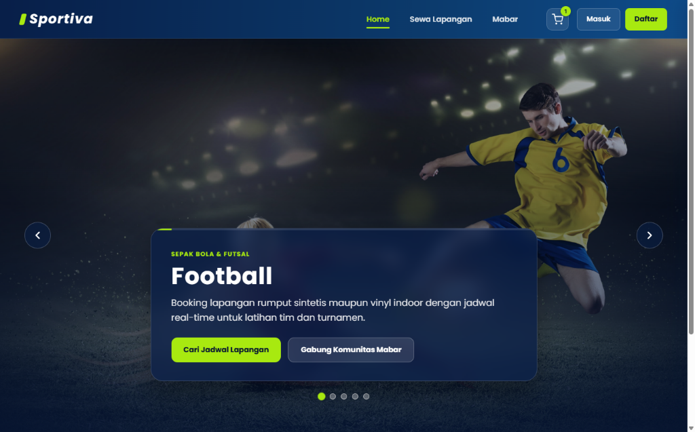
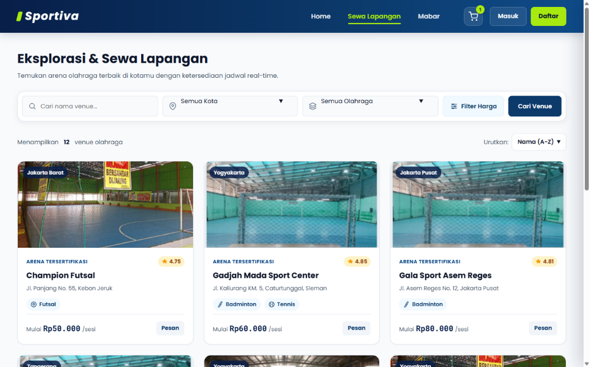
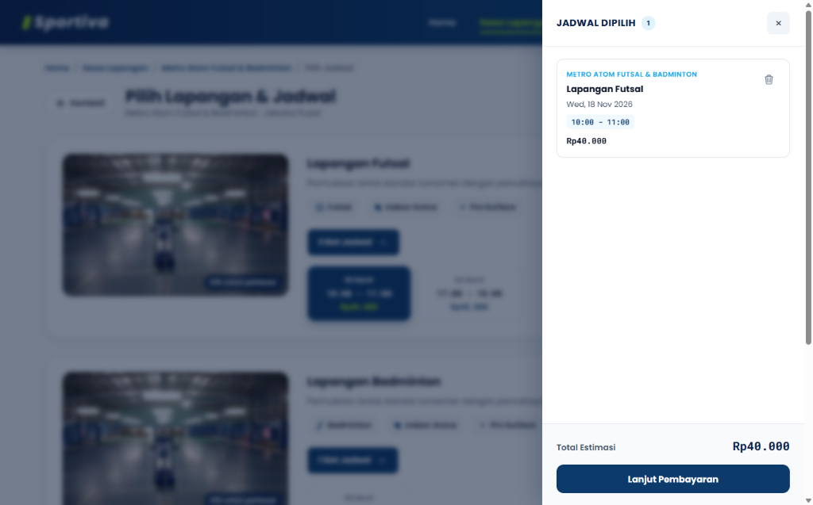
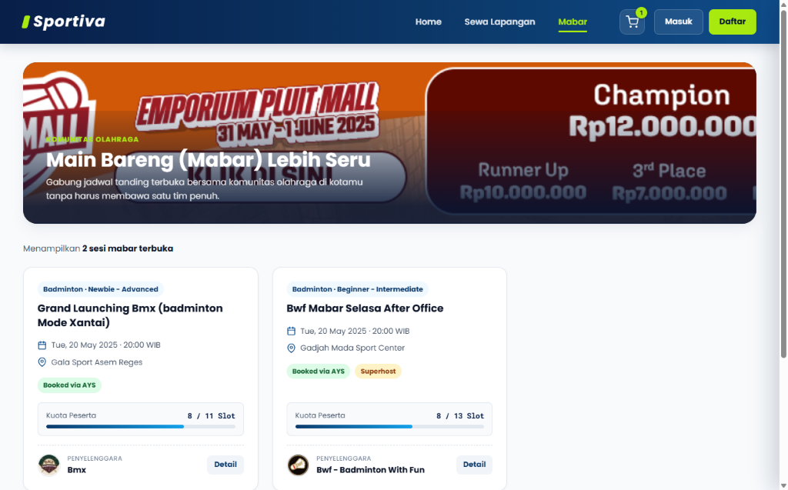
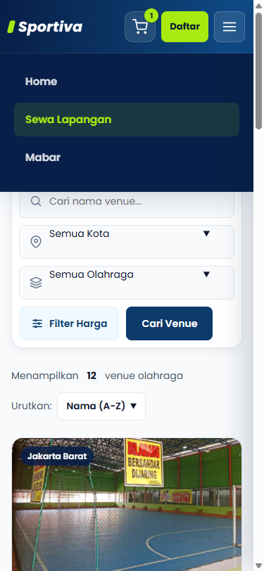

# Sportiva - Platform Booking Lapangan & Komunitas Mabar

**Sportiva** adalah aplikasi web berbasis PHP & MySQL (PDO) untuk pencarian dan pemesanan jadwal lapangan olahraga (*Futsal, Badminton, Basket, Tennis, Voli*) secara real-time sekaligus wadah bergabung ke jadwal tanding komunitas **Mabar (Main Bareng)** di berbagai kota Indonesia.

Proyek ini menggunakan sistem desain **Arena Kinetic** dengan palet *Deep Arena Navy* (`#081F49` – `#0C3A6B`), *Court Sky* (`#14A4EE`), dan aksen tunggal *Volt Lime* (`#A8E910`), serta animasi berbasis GPU compositor (`transform` & `opacity`) yang mulus dan responsif di perangkat desktop maupun mobile.

---

## Tentang Proyek & Ruang Lingkup (Mata Kuliah UI/UX Design)

> **Catatan Akademik:** Website **Sportiva** dikembangkan sebagai **Proyek Akhir / Tugas Besar untuk memenuhi Mata Kuliah UI/UX Design**.

Fokus utama dari pengembangan proyek ini adalah menerjemahkan hasil riset pengalaman pengguna (*User Experience*) dan perancangan antarmuka (*User Interface*) dari tahap prototipe desain ke dalam aplikasi web interaktif yang fungsional:
- **Fokus Implementasi UI/UX**: Mengutamakan kejelasan hierarki visual (*visual hierarchy*), kemudahan alur eksplorasi & pemesanan (*user flow*), konsistensi sistem desain (*design tokens*), mikro-interaksi, umpan balik instan (*toast notifications*, *interactive states*), serta aksesibilitas dan responsivitas lintas perangkat.
- **Batasan Ruang Lingkup (Tidak Sampai Payment Gateway)**: Sesuai dengan cakupan evaluasi mata kuliah **UI/UX Design**, alur transaksi pada proyek ini difokuskan pada pengalaman pencarian venue, penyaringan jadwal, pemilihan slot waktu ke dalam *Global Cart Drawer*, serta simulasi bergabung ke sesi *Mabar*. Tahap **integrasi pembayaran (*payment gateway* / transaksi finansial nyata)** tidak diimplementasikan dan berhenti pada tahap konfirmasi/ringkasan estimasi pesanan di keranjang jadwal.

---

## Tampilan Aplikasi (Screenshots)

### 1. Halaman Utama (Hero Slider Interaktif)
Menampilkan *hero slider* lintas cabang olahraga dengan efek *cross-fade*, indikator progres waktu nyata, dan pintasan cepat menuju pencarian jadwal lapangan maupun komunitas Mabar.



### 2. Eksplorasi & Filter Sewa Lapangan
Pencarian venue berdasarkan nama, kota, cabang olahraga, pengurutan harga/nama, serta modal filter rentang biaya per sesi dengan animasi masuk kartu bertahap (*staggered card reveal*).



### 3. Pemilihan Slot Jadwal & Global Cart Drawer
Halaman pemilihan lapangan dan slot jam bermain real-time yang terhubung langsung dengan *Global Cart Drawer* (`actions/cart_manager.php`) berbasis session dan notifikasi *toast* interaktif.



### 4. Komunitas Main Bareng (Mabar)
Daftar sesi tanding terbuka lengkap dengan indikator progres kuota peserta (`slots_filled / total_slots`), badge penyelenggara, serta halaman detail acara dinamis.



### 5. Responsivitas Mobile (Mobile Navigation Drawer)
Tata letak responsif dengan *navigation drawer* mobile dan ukuran tombol ramah sentuhan (*minimum tap target* `44px`).

<p align="left">
  
</p>

---

## Struktur Direktori

Seluruh kode sumber telah dikelompokkan berdasarkan tanggung jawabnya agar direktori root tetap bersih dan mudah dikelola:

```text
Sportiva/
├── actions/                        # Endpoint proses backend & API session
│   ├── auth.php                    # Proses autentikasi Login & Registrasi user (Bcrypt)
│   ├── cart_manager.php            # JSON API keranjang jadwal (add, remove, get)
│   └── logout.php                  # Penghapusan session & logout akun
├── assets/                         # Seluruh aset statis frontend
│   ├── css/                        # Modular stylesheets (Zero Inline CSS)
│   │   ├── global.css              # Design tokens, Reset, Header, Mobile Nav, Footer, Toast
│   │   ├── sidebar_styles.css      # Global Cart Drawer / Sidebar
│   │   ├── auth_styles.css         # Modal Login & Registrasi
│   │   ├── home_styles.css         # Hero Slider halaman utama
│   │   ├── sewa_lapangan_styles.css# Grid pencarian venue, filter modal & paginasi
│   │   ├── venue_detail_styles.css # Detail venue, fasilitas, paket member & slot jadwal
│   │   ├── mabar_styles.css        # Katalog event Mabar & halaman detail Mabar
│   │   └── otp_styles.css          # Alur verifikasi keamanan OTP 3 langkah
│   ├── js/                         # Script interaktivitas frontend
│   │   ├── main.js                 # Cart sync, Auth Modal, Mobile Menu, Toast, Hero Slider
│   │   └── otp.js                  # Auto-advance input digit & transisi langkah OTP
│   ├── images/                     # Gambar venue, logo komunitas, avatar & banner slider
│   │   ├── avatars/                # Avatar peserta Mabar
│   │   └── slider/                 # Gambar background Hero Slider utama
│   └── screenshots/                # Dokumentasi tangkapan layar aplikasi untuk README
├── config/
│   └── database.php                # Konfigurasi koneksi PDO MySQL & auto-sinkronisasi aset
├── db/
│   └── sportiva_db.sql             # Dump skema dan data awal database MySQL
├── includes/
│   ├── header.php                  # Komponen Header, Navbar & Cart Badge
│   └── footer.php                  # Komponen Footer, Cart Drawer, Toast & Auth Modal
├── pages/                          # Halaman-halaman tampilan aplikasi
│   ├── sewa_lapangan.php           # Katalog pencarian, filter & paginasi venue
│   ├── venue_detail.php            # Informasi lengkap venue, fasilitas, aturan & membership
│   ├── ketersediaan_venue.php      # Pemilihan lapangan & slot waktu sewa
│   ├── mabar.php                   # Daftar event Main Bareng (Mabar) komunitas
│   ├── mabar_detail.php            # Detail sesi Mabar dinamis & pendaftaran peserta
│   └── otp.php                     # Halaman verifikasi kode OTP pasca login/registrasi
├── .gitignore                      # Konfigurasi file yang diabaikan oleh Git
├── index.php                       # Entry point utama (Landing Page / Home)
└── README.md                       # Dokumentasi proyek
```

---

## Fitur Utama

1. **Pencarian & Filter Multi-Kriteria (`pages/sewa_lapangan.php`)**:
   - Filter berdasarkan kata kunci nama venue, kota, cabang olahraga, dan rentang harga minimum/maksimum per sesi.
   - Pengurutan dinamis berdasarkan abjad (`A-Z`, `Z-A`) maupun harga (`Termurah`, `Termahal`) dengan dukungan paginasi.
2. **Pemilihan Jadwal & Keranjang Real-Time (`pages/ketersediaan_venue.php` & `actions/cart_manager.php`)**:
   - Menampilkan status slot tersedia vs *Booked* dengan format harga dan waktu monospasi yang mudah dipindai.
   - Sinkronisasi keranjang berbasis session PHP tanpa *reload* halaman menggunakan Fetch API.
3. **Komunitas Mabar Dinamis (`pages/mabar.php` & `pages/mabar_detail.php`)**:
   - Visualisasi kuota peserta menggunakan *progress bar* dan daftar avatar partisipan.
   - Halaman detail terhubung langsung dengan tabel `mabar_events` berdasarkan parameter `?id=`.
4. **Autentikasi & Verifikasi OTP (`actions/auth.php` & `pages/otp.php`)**:
   - Modal Login & Registrasi dengan transisi geser halus, *password hashing* `PASSWORD_BCRYPT`, dan simulasi verifikasi OTP 4 digit interaktif.
5. **Sistem Animasi Modern & Aksesibel**:
   - Menggunakan kurva transisi `--ease-out: cubic-bezier(0.23, 1, 0.32, 1)` dan `--ease-drawer: cubic-bezier(0.32, 0.72, 0, 1)`.
   - Mendukung penuh navigasi keyboard (`Tab`, `Enter`, `Escape`), indikator fokus `:focus-visible`, serta aturan `@media (prefers-reduced-motion: reduce)`.

---

## Panduan Instalasi & Menjalankan di Lokal (XAMPP)

1. **Clone Repository ke Folder `htdocs`**:
   ```bash
   cd C:/xampp/htdocs
   git clone <url-repository-anda> Sportiva
   ```
2. **Nyalakan Apache & MySQL**:
   - Buka **XAMPP Control Panel**, lalu klik **Start** pada modul **Apache** dan **MySQL**.
3. **Impor Database**:
   - Buka `http://localhost/phpmyadmin` di browser.
   - Buat database baru bernama **`sportiva_db`**.
   - Pilih tab **Import**, unggah file [`db/sportiva_db.sql`](db/sportiva_db.sql), lalu klik **Import / Go**.
4. **Konfigurasi Koneksi Database (Opsional)**:
   - Secara default, [`config/database.php`](config/database.php) menggunakan `host = localhost`, `dbname = sportiva_db`, `user = root`, dan `pass = ''` (standar XAMPP). Sesuaikan jika konfigurasi MySQL lokal Anda berbeda.
5. **Akses Aplikasi**:
   - Buka browser dan kunjungi: `http://localhost/Sportiva/`
